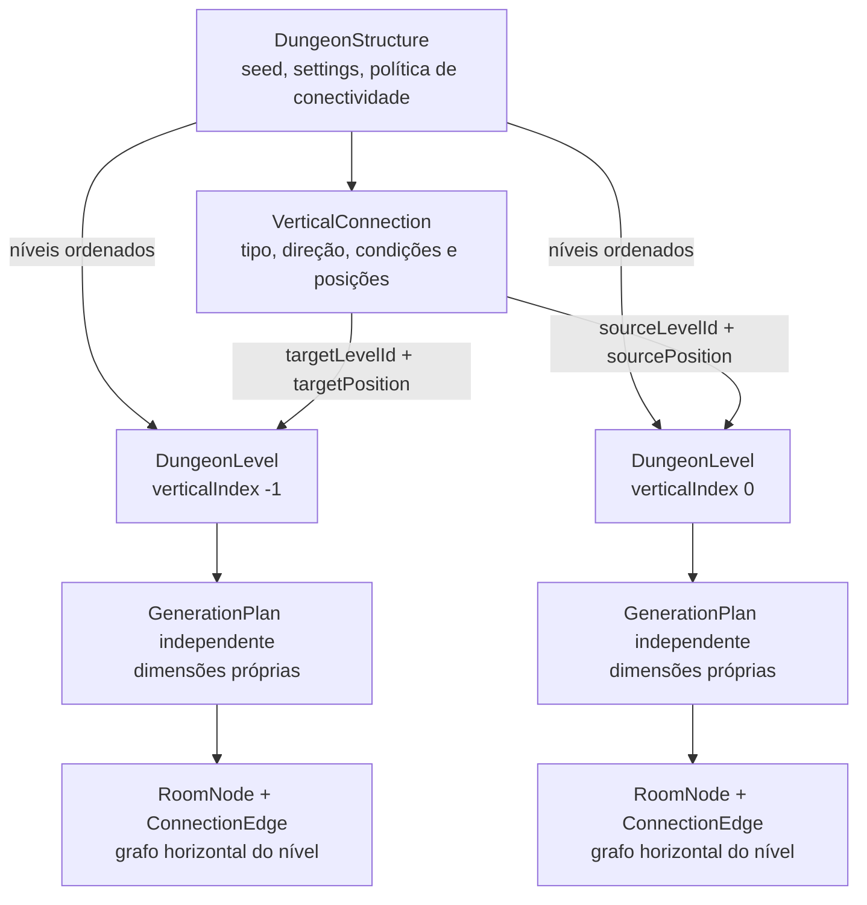
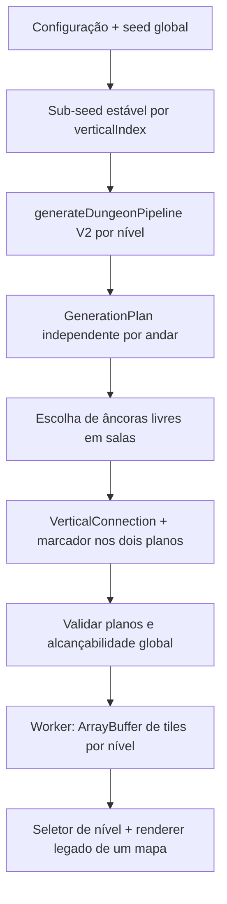

# Arquitetura e desenvolvimento

Este documento descreve as fronteiras atuais do gerador e os procedimentos para alterá-lo sem acoplar geração, interface e renderização. A arquitetura evolui incrementalmente; a V1 e o formato `Dungeon.tiles` continuam sendo contratos compatíveis.

## Visão geral

```text
Parâmetros da interface
  -> App.tsx / useDungeonGeneration
  -> execução síncrona ou GenerationWorkerRunner
  -> solicitação de mapa único ou DungeonStructure
       -> mapa único: generateDungeonPipeline
       -> multinível: generateDungeonPipeline V2 por andar
              -> GenerationPlan por nível -> links verticais -> validação global
  -> tiles legados por mapa, consumidos por PixiJS, Three.js e exportação SVG/PNG
```

O Worker chama o mesmo `generateDungeonPipeline` usado na execução síncrona; não existe uma segunda implementação dos algoritmos. A interface escolhe a execução em Worker por `área × max(salas, iterações celulares aplicáveis)`, a partir de 10.000 unidades. O limite foi calibrado por benchmarks locais: 32×24/6 (4.608 unidades) levou cerca de 21 ms síncrono; 64×48/12 (36.864 unidades) levou cerca de 139 ms, então mapas médios desse custo também usam Worker. São heurísticas, não garantias de latência. O cancelamento termina o Worker ativo e IDs de solicitação impedem que um resultado antigo substitua o mais recente. O pipeline ainda não fornece progresso percentual por etapa.

## Responsabilidades dos módulos

| Módulo | Responsabilidade |
|---|---|
| `src/core/types.ts`, `tiles.ts`, `random.ts` | Tipos comuns, IDs de tiles e fontes determinísticas de aleatoriedade. |
| `src/core/content/` | Regras e valores dos elementos de conteúdo gerados, como portas, armadilhas, tesouros e líquidos. |
| `src/core/generation/` | Primitivas de grid e algoritmos legados BSP, Cellular Automata, Drunkard's Walk e híbrido. |
| `src/dungeon.ts` | Modelo legado `Dungeon`, parâmetros e APIs públicas da V1; também mantém regras de geração e edição que ainda não foram extraídas. É a maior concentração de responsabilidades restante. |
| `src/dungeonProfiles.ts`, `src/customDungeonProfile.ts`, `src/generationRoomRecipe.ts` | Perfis registrados, validação/resolução de sobreposições customizadas e receita BSP de dimensões e conteúdo de salas usada pela V2. |
| `src/generationPlan.ts` | Modelo lógico independente dos renderizadores: salas, conexões, regiões naturais em spans, links entre cavernas e estruturas, setores, transições e features. |
| `src/generationTopology.ts` | Grafo de exploração, caminho principal, ramificações, ciclos, setores e análise de acessibilidade. Não posiciona nem roteia a geometria. |
| `src/generationSpatialLayout.ts` | Posição e ajuste das salas, sem rasterizar tiles ou desenhar corredores. |
| `src/generationCorridorGeometry.ts`, `src/generationCorridorRouter.ts` | Footprint compartilhado de corredores e roteamento A* determinístico, com portas e junções. |
| `src/generationPlanValidation.ts` | Validação estrutural e geométrica do plano, incluindo footprints, conectividade de regiões naturais e links de cavernas. |
| `src/generationCavern.ts` | Gera cavernas determinísticas por Cellular Automata, compacta regiões navegáveis em spans e liga cavernas híbridas à estrutura por caminhos ortogonais. |
| `src/generationPlanToDungeon.ts` | Adaptador final do `GenerationPlan` para `Dungeon.tiles` e detalhes que os consumidores existentes entendem. |
| `src/dungeonStructure.ts`, `src/dungeonStructureValidation.ts` | Modelo lógico multinível, links verticais explícitos e validação entre níveis. |
| `src/dungeonStructureGeneration.ts` | Gera cada nível pelo pipeline V2, cria âncoras de conexões verticais e valida a estrutura global. |
| `src/dungeonStructureToDungeon.ts` | Projeção explícita de um nível lógico para o contrato legado de mapa único. |
| `src/generationPipeline.ts` | Coordena V1/V2, métricas e fallbacks explícitos com motivo e etapa. |
| `src/generationWorkerProtocol.ts`, `generationWorkerRunner.ts`, `generationWorkerRuntime.ts`, `generation.worker.ts` | Mensagens tipadas, seleção/execução/cancelamento do Worker e empacotamento dos tiles em buffer transferível. |
| `src/ui/`, `src/App.tsx`, `src/useDungeonGeneration.ts` | Controles, estado React, formulários e integração com o serviço de geração. `App.tsx` ainda é um módulo grande de coordenação. |
| `src/rendering/` | Renderização PixiJS e Three.js, semântica de tiles, SVG e descarte de recursos gráficos. |
| Fachadas em `src/DungeonCanvas.tsx`, `src/DungeonThreeCanvas.tsx` e `src/DungeonExportControl.tsx` | Compatibilidade com imports públicos existentes; código novo da aplicação deve preferir os caminhos canônicos em `rendering/` e `ui/components/`. |

Os módulos de geração não importam React, PixiJS nem Three.js. A dependência remanescente de `Dungeon` em alguns tipos de planejamento é de domínio/compatibilidade, não de renderização. A geração BSP também importa um tipo de sala de `dungeon.ts` como importação apenas de tipo; o build apaga essa referência, mas a extração dos tipos legados para uma camada neutra continua sendo uma possível melhoria.

## Dados e fluxo de geração

`Dungeon` é o contrato legado: dimensões, `Tile[][]`, detalhes de salas e elementos renderizados. A V1 continua disponível e `generateDungeon` mantém sua API compatível.

`GenerationPlan` é o modelo lógico/geométrico usado pela V2. `RoomNode.roomRole` (por exemplo, entrada, objetivo ou conector) é independente de `roomType` (categoria temática); cada sala possui um footprint explícito. `ConnectionEdge` registra endpoints, estado de acesso, largura e caminho; transições e features são entidades separadas. Cavernas são `NaturalRegion`s não retangulares, armazenadas como spans horizontais inclusivos no início e exclusivos no fim; `CaveConnection` modela explicitamente o caminho até uma sala ou corredor. A geração mantém esses dados fora da matriz completa até a conversão final.

Perfis customizados usam `profile: "custom"` e um objeto `customProfile` validado em `customDungeonProfile.ts`. `baseProfile` é obrigatório; campos de conteúdo, topologia e preferências V2 são opcionais e herdam do perfil-base. O validador rejeita chaves desconhecidas e enumerações/valores incompatíveis antes de iniciar qualquer geração. O objeto validado segue no mesmo pedido síncrono ou do Worker, inclusive em gerações multinível; cada nível pode sobrescrever o perfil. Dimensões, quantidade de salas e parâmetros de corredores continuam pertencendo ao pedido de geração (`DungeonParameters` e configuração do nível), em vez de duplicarem valores temáticos do perfil.

O caminho V2 é:

1. Criar uma receita BSP de salas e conteúdo compatível com os perfis existentes.
2. Preparar o plano com as salas e seus metadados.
3. Gerar topologia e caminho principal usando o subfluxo RNG `topology`.
4. Posicionar salas usando o subfluxo `placement`.
5. Transferir conteúdo e elementos da receita.
6. Roteiar conexões com o subfluxo `corridors`.
7. Validar o plano e sua geometria.
8. Rasterizar uma única vez para o contrato `Dungeon.tiles`.

Na topologia V2, uma fração determinística das conexões elegíveis recebe portas comuns, definida pelo perfil (fortaleza 40%, prisão 45%, laboratório e catacumbas 30%, templo e civilização perdida 20%, mina 10%, caverna 0%; arredondada para cima, com pelo menos uma quando a fração é positiva e há conexão elegível). Portas secretas ou trancadas e passagens bloqueadas mantêm suas regras próprias.

Regras de abertura (modelo lógico → tiles):

- Uma abertura é a faixa de `openingPositions` (uma por tile de largura do corredor) logo fora da parede da sala. Somente um endpoint de conexão pode criar essa abertura: o A* rejeita células de corredor encostadas em qualquer sala (`ringRoomAt`), exceto o estado inicial/final do endpoint, e `carveIntersection` não escava vestíbulos ou junções alargadas contra a parede fora de uma abertura real.
- Uma conexão com porta gera uma transição por tile da abertura, em cada extremidade, e nunca duas na mesma célula. Portanto a porta sempre veda a largura inteira do corredor (1, 2 ou 3 tiles); `doubleDoorsEnabled` continua restrito à V1.
- Janelas de saída vizinhas a aberturas de portas ficam livres de outros corredores, para que duas portas nunca se fundam em uma única porta larga.
- `validateDoorGeometry` (`src/generationDoorValidation.ts`) confere plano × tiles depois da rasterização: porta sem conexão, posição fora da abertura, tipo divergente, duplicidade, tile de porta órfão, orientação, porta desconectada, abertura sem passagem, abertura de porta sem vedação e `wall-breach` (corredor encostado numa sala fora de um endpoint). A pipeline V2 roda essa validação e, se houver qualquer problema, informa o fallback V1 com o motivo.
- Renderizadores agrupam tiles de porta contíguos pelo eixo de passagem (`src/rendering/doorwayLayout.ts`) e desenham uma única porta alinhada à grade, com a largura do vão; portas empilhadas ao longo de uma passagem continuam separadas.

Na V2 de salas, a receita BSP tenta atender à quantidade solicitada em até cinco execuções determinísticas, reduzindo progressivamente a compactação dos corredores e mantendo o melhor resultado por quantidade de salas. Se ainda faltar uma sala, o pipeline não reduz a contagem silenciosamente: usa o fallback V1 identificado, informa quantas salas foram solicitadas e geradas, a quantidade mínima aceitável e o motivo. O layout também tem tentativas limitadas: relaxa o espaçamento até o mínimo compatível com a largura dos corredores e, por fim, pode redimensionar salas; o pipeline tenta estilos alternativos sem remover salas. `validateGenerationPlan` rejeita qualquer plano de salas cuja contagem difira da solicitada, e o adaptador valida novamente antes da rasterização. O modo natural-cavern é uma exceção explícita: seu plano contém zero salas e uma ou mais regiões navegáveis.

Os subfluxos determinísticos isolam decisões de topologia, posicionamento, corredores, conteúdo, decoração e cavernas. O horário de execução e as métricas não participam do resultado. O perfil Caverna natural usa Cellular Automata para gerar uma região navegável conectada sem criar `RoomNode`s. A opção híbrida acrescenta a maior região celular que não sobrepõe salas, corredores ou features e escava um caminho ortogonal até o grafo construído; se não houver espaço viável, o pipeline recorre explicitamente à V1 com motivo e etapa. Densidade celular e iterações controlam a proporção navegável e a irregularidade; a V2 limita as iterações a 12 para manter o custo finito. Entradas externas continuam usando fallback V1.

`validateGenerationPlan` valida spans ordenados, limites, sobreposição e conectividade ortogonal de cada região, além da origem, continuidade e destino de cada link cavernoso. O adaptador rasteriza regiões e passagens como `CAVE_TILE`, aplica escadas de referência à região natural e mantém a saída `Dungeon.tiles` para os renderizadores existentes. A geração multinível continua sem suporte a cavernas nesta etapa.

O adaptador recusa planos topológicos ainda não roteados, planos inválidos e conexões verticais. A representação `Dungeon` atual é de um único nível e não pode preservar todas as propriedades lógicas de acesso; não se deve inferir navegação além dos dados que o modelo legado representa.

## Fundação para dungeons multinível

`DungeonStructure` é a composição lógica completa; não substitui nem altera o contrato legado `Dungeon`. Cada `DungeonLevel` possui um `GenerationPlan` próprio, portanto seus limites, salas, dimensões e grafo horizontal são independentes. `RoomNode.floorId` deve corresponder ao ID do nível que contém o plano. Links entre planos vivem exclusivamente em `DungeonStructure.verticalConnections`, separados dos `ConnectionEdge` horizontais.



`verticalIndex` é um inteiro assinado: índices menores ficam mais abaixo; a lista `levels` deve estar em ordem estritamente crescente, por exemplo, `-2` (subsolo profundo), `-1` (subsolo), `0` (referência) e `1` (torre). IDs de níveis e links podem ser criados com `createStableGenerationId(dungeonId, "level" | "vertical-connection", ordinal)`; IDs de salas e conexões horizontais permanecem no escopo do `GenerationPlan` do nível.

O validador valida cada plano com `validateGenerationPlan`, exige IDs sem duplicação entre níveis, garante que cada sala pertença ao seu nível e rejeita `ConnectionEdge` vertical dentro do grafo horizontal. As posições dos dois extremos de cada link devem estar dentro das dimensões próprias do nível e coincidir com footprint de sala ou footprint roteado de corredor. Conectividade global é opcional; quando habilitada, exige `entryLevelId` e verifica alcance respeitando a direção dos links. As condições de acesso são preservadas como dados, mas ainda não são avaliadas pelo verificador estrutural. Links paralelos são válidos.

Exemplo de dois níveis; `subsoloPlan` e `principalPlan` são planos completos validados independentemente:

```ts
const levels = [
  {
    id: createStableGenerationId("fortaleza", "level", 0),
    name: "Subsolo",
    verticalIndex: -1,
    plan: subsoloPlan,
    metadata: {},
  },
  {
    id: createStableGenerationId("fortaleza", "level", 1),
    name: "Principal",
    verticalIndex: 0,
    plan: principalPlan,
    metadata: {},
  },
];

const dungeon: DungeonStructure = {
  id: "fortaleza",
  name: "Fortaleza",
  generation: { seed: 8342, generatorVersion: "v2", generatedAt: "2026-01-01T00:00:00.000Z" },
  settings: {},
  connectivity: { requireGlobalConnectivity: true, entryLevelId: levels[1].id },
  levels,
  verticalConnections: [{
    id: createStableGenerationId("fortaleza", "vertical-connection", 0),
    sourceLevelId: levels[1].id,
    targetLevelId: levels[0].id,
    sourcePosition: { x: 12, y: 8 },
    targetPosition: { x: 7, y: 11 },
    kind: "spiral-stairs",
    direction: "bidirectional",
    metadata: {},
  }],
  metadata: {},
};
```

Exemplo de três níveis com duas rotas paralelas entre o principal e o primeiro subsolo, além de uma ligação ao subsolo profundo:

```ts
const levels = [
  { id: createStableGenerationId("mina", "level", 0), name: "Veio profundo", verticalIndex: -2, plan: deepPlan, metadata: {} },
  { id: createStableGenerationId("mina", "level", 1), name: "Galeria", verticalIndex: -1, plan: galleryPlan, metadata: {} },
  { id: createStableGenerationId("mina", "level", 2), name: "Entrada", verticalIndex: 0, plan: entrancePlan, metadata: {} },
];

const verticalConnections = [
  { id: createStableGenerationId("mina", "vertical-connection", 0), sourceLevelId: levels[2].id, targetLevelId: levels[1].id, sourcePosition: { x: 6, y: 8 }, targetPosition: { x: 9, y: 4 }, kind: "stairs", direction: "bidirectional", metadata: {} },
  { id: createStableGenerationId("mina", "vertical-connection", 1), sourceLevelId: levels[2].id, targetLevelId: levels[1].id, sourcePosition: { x: 14, y: 8 }, targetPosition: { x: 18, y: 4 }, kind: "elevator", direction: "source-to-target", accessRequirements: ["power-restored"], metadata: {} },
  { id: createStableGenerationId("mina", "vertical-connection", 2), sourceLevelId: levels[1].id, targetLevelId: levels[0].id, sourcePosition: { x: 9, y: 15 }, targetPosition: { x: 5, y: 12 }, kind: "vertical-shaft", direction: "bidirectional", metadata: {} },
];
```

`dungeonStructureToDungeon(structure)` converte automaticamente apenas estruturas de um nível. Para vários níveis, o chamador deve informar `levelId`; o resultado é uma projeção desse andar para `Dungeon.tiles`, não um achatamento da dungeon. A estrutura original continua sendo a fonte do grafo vertical, que o formato legado e os renderizadores atuais não representam.

## Geração multinível inicial

`generateDungeonStructure` chama `generateDungeonPipeline` uma vez por nível, sempre solicitando V2. Se o pipeline recorrer à V1 ou não retornar um `GenerationPlan`, o nível é regenerado com até três sub-seeds derivados (`level-retry:<n>`, registrado em `DungeonLevel.metadata.generationAttempts`); se todas as tentativas falharem, a geração multinível falha com o nome do nível e o motivo; não apresenta um resultado V1 como se fosse V2. Cada plano passa por sua validação normal antes de receber as transições verticais.



O sub-seed do plano usa `deriveRandomSeed(seed, "multilevel-level:<verticalIndex>")`; alterar largura, quantidade de salas ou seed de outro nível não desloca os streams deste nível. As conexões verticais usam um stream derivado separado. O grafo global calcula alcançabilidade dirigida a partir do nível de entrada, componentes, níveis isolados e o número de ciclos, incluindo conexões paralelas. A política pode exigir conectividade global ou permitir níveis opcionais/secretos desconectados; quando desconectados, a interface os identifica.

Cada conexão seleciona uma célula de sala livre em ambos os planos, grava `verticalConnectionId` em uma transição de cada nível e é validada contra essas duas âncoras. Escadas são rasterizadas como tiles de subida/descida; outros tipos usam o marcador legado de conexão vertical. O tipo semântico permanece em `VerticalConnection`. A interface mostra um nível de cada vez nos renderizadores atuais, permite selecionar o andar e lista tipo, par de níveis e coordenadas dos links.

As requisições do Worker têm variantes tipadas para mapa único e estrutura multinível, reutilizam o runner/cancelamento/stale-guard existentes e transferem um `ArrayBuffer` de tiles por nível. Os `GenerationPlan`s não são transferidos para a UI: permanecem no resultado lógico do serviço, enquanto a tela recebe a estrutura sem planos e os mapas legados necessários para navegação e renderização. Para custo pequeno, a estimativa de trabalho soma `área × max(salas, iterações celulares aplicáveis)` de todos os níveis; a mesma fronteira de 10.000 unidades decide entre execução síncrona e Worker. A interface inicia com a quantidade de salas do nível principal como referência; os demais andares variam em torno dela e cada nível pode ser ajustado individualmente.

Os andares que não são o principal recebem dimensões e quantidade de salas pseudoaleatórias e determinísticas próximas às do principal (`deriveNearbyLevelSize`: ±18% nas dimensões e ±25% nas salas, a partir da seed e do `verticalIndex`), salvo ajuste individual. O limite de salas é `MAX_DUNGEON_ROOM_COUNT = 48`, com teto efetivo por grade de cerca de 260 tiles por sala (`getMaxRoomCountForGrid`, mínimo 12); em grades pequenas, valores altos podem recorrer explicitamente à V1. O roteador ainda não cruza corredores não relacionados, o que limita a V2 em mapas muito grandes com muitas salas.

Cavernas em vários níveis: `cavesEnabled` (hybrid) vale para todos os andares, e um andar pode usar `profile: "natural-cavern"` (sem salas). As âncoras verticais ganham um segundo conjunto de células de região natural; uma conexão usa cavernas com 35% de chance para tipos naturais (poço, queda, rampa) e 8% para construídos (escadas, elevador, alçapão), e recorre às salas se as âncoras de caverna estiverem longe demais para escadas. A transição vertical numa caverna referencia `regionId` em vez de `roomId`, e `collectSpatialAnchors` aceita regiões e passagens cavernosas.

`allowLongVerticalConnections` permite que tipos que não sejam escadas liguem um andar a outro mais distante (por exemplo 1 e 4): a árvore geradora conecta cada andar a um anterior, às vezes longe; escadas continuam entre andares vizinhos.

Limites desta primeira versão: de 2 a 8 níveis, no máximo 1.000.000 de tiles somados e 48 salas solicitadas por nível; cada nível também respeita os limites individuais de dimensão. O teto de oito níveis limita o número de pipelines, buffers transferidos e controles simultâneos nesta primeira UI, enquanto o orçamento agregado preserva a proteção de memória já usada para um mapa. Apenas a entrada superior por escadas é aceita; acessos externos são rejeitados em vez de usar fallback. A interface aplica um perfil global, mas permite dimensões, salas, topologia, layout espacial e caverna natural próprios por nível. Links gerados são bidirecionais; direções e requisitos de acesso continuam suportados pelo modelo, mas ainda não são configuráveis na interface.

A exportação de dungeons multinível (`dungeonStructureSvg.ts`) gera uma folha única com todos os andares, do mais alto ao mais profundo, cada um rotulado com seu nível e dimensões, marcadores V1, V2… nas âncoras verticais, linhas tracejadas entre elas e uma legenda com tipo e coordenadas; o menu oferece SVG/PNG de todos os níveis ou apenas do nível atual.

Variantes de porta: `Dungeon.doorVariants` (chave `"x,y"`) acompanha o tile de porta comum com `reinforced`, `open`, `destroyed`, `gate`, `grate` ou `locked`. A variante vem de `ConnectionEdge.metadata.doorVariant` (sorteio determinístico por perfil, em `generationTopology.ts`) ou de `locked`, é copiada para as transições, rasterizada para o `Dungeon` e validada (toda a abertura usa a mesma variante). 2D, SVG e 3D desenham cada variante a partir de `getDoorwayDrawing`, e portas duplas, horizontais ou verticais, mostram puxadores unidos por uma trava.

## Validação, dimensões e renderização

`validateGenerationPlan` verifica consistência estrutural e geométrica antes da conversão. `validateDungeonTopology` verifica caminho principal, conectividade física, acesso do jogador, setores e ciclos. O roteador verifica as rotas durante e após a busca. Os benchmarks também comparam conectividade do grafo com conectividade observada no grid.

O limite atual é de 1.000.000 de tiles por mapa, com no máximo 1.000 tiles por eixo. Isso permite 1000×1000, mas não representa um compromisso de geração instantânea. O roteador aloca quatro estados direcionais por tile, com `Float64Array`, `Int32Array` e `Uint32Array`, além de dois arrays por tile; o workspace tipado máximo é aproximadamente 72 MB no teto, além de `roomAt`, obstáculos, heap A*, grids da V1/receita e `Dungeon.tiles`. Cada conexão tem uma busca inicial limitada a 100.000 estados e uma única busca adicional limitada a 250.000; ambas compartilham um orçamento cumulativo máximo de 350.000 estados, incluindo bounds locais e tentativas de largura. Esgotar o teto gera um erro explícito e interrompe novas tentativas de layout; a pipeline informa o fallback V1 e a conexão que falhou. Dimensões maiores são recusadas antes de alocar esses buffers. O Worker é selecionado por estimativa de trabalho; Pixi usa uma base rasterizada e desenha detalhes apenas na região visível, enquanto exportação mantém o limite de 16 milhões de pixels.

O `GenerationPlan` mantém salas e conexões como entidades lógicas, sem exigir `Tile[][]` para topologia ou layout. O roteador cria buffers tipados densos por tile, restringe a expansão A* a bounds locais que crescem somente quando a rota exige e limita o trabalho total de cada conexão. O BSP usado como receita V2 ainda produz um `Dungeon` legado, e a conversão final também rasteriza `Tile[][]` para preservar os consumidores atuais. Os benchmarks validam 160×120 até 1000×1000; em 1000×1000, a V2 roteou 6 salas sem fallback, enquanto 24 salas atingiram o teto em uma conexão e usaram fallback V1 com as 24 salas preservadas. Por isso, chunks e uma nova estrutura espacial de colisão não foram introduzidos: a matriz final continua necessária aos renderizadores atuais, mas o roteamento tem uma limitação explícita para evitar buscas que durem minutos.

PixiJS, Three.js e SVG consomem `Dungeon`, não `GenerationPlan`. `dungeonTileSemantics.ts` mantém paleta e classificação compartilhadas. A geometria e o ciclo de vida de cena continuam específicos de cada renderer; os recursos Three.js são descartados pelo helper dedicado.

A visualização 3D de dungeons multinível (`src/rendering/multilevelThree.ts`) recebe todos os níveis e as `verticalConnections`. O nível ativo mantém o construtor detalhado e a seleção de salas; os demais são construídos com instancing (pisos, paredes, portas, escadas, pilares) e posicionados em `y = (verticalIndex − índice do topo) × distância`, de modo que selecionar outro andar nunca move a pilha. Os modos são Nível (um andar), Pilha (distância compacta) e Explodida (distância ajustável), com visibilidade por andar, níveis acima do ativo sólidos/fantasma/ocultos, clique em um andar para ativá-lo e destaque das conexões verticais. Cada conexão vira geometria física entre as coordenadas de origem e destino: escadas e rampas são degraus que sobem de um andar ao outro, escadas em espiral são helicoidais, e poços, elevadores, alçapões e quedas são colunas com anéis nos dois pisos. Sombras suaves ficam ativas até 20.000 tiles por nível. Os benchmarks medem etapas de geração, rasterização e serialização SVG, mas não isolam tempo de GPU nem pico de memória. O smoke test no navegador confirmou a troca 2D/3D e o cancelamento do Worker sem erros; métricas e limitações estão em [docs/v2-audit.md](./v2-audit.md).

Os resultados reproduzíveis por dimensão, seed, número de salas e estágio estão na seção [Limites de escala](../README.md#limites-de-escala) do README.

### Estilo cartográfico (2D e 3D)

A base do mapa 2D é gerada por `src/rendering/cartographicMap.ts`, um "shader" em software que converte o `Dungeon` em uma imagem RGBA. A sheet `src/rendering/assets/dungeon-texture-sheet.jpg` é uma composição, não uma grade de tiles reutilizável: o renderer usa somente dois recortes manuais sem objetos embutidos — piso de pedra em `(448, 208, 32, 32)` e alvenaria em `(560, 128, 32, 32)`. O piso é aplicado apenas a tiles arquitetônicos e recebe uma sobreposição de cor semântica a 18% de opacidade; paredes são desenhadas em células `WALL_TILE` adjacentes ao piso ou em cantos diagonais fechados por duas paredes, com rotação do tile para completar o encontro. As hachuras de contorno e as emendas entre grupos de piso foram removidas. Portas continuam como sobreposições vetoriais alinhadas à abertura, preservando variantes e larguras. O atlas `src/rendering/assets/water-lava-texture-atlas.png` fornece água `(64, 64, 96, 96)` e lava `(64, 432, 96, 96)` somente para os tiles correspondentes; cada textura é repetida como um padrão contínuo recortado à máscara dos tiles líquidos, em vez de carimbar a mesma imagem em cada célula. Cascatas, fontes, respiradouros e demais detalhes permanecem vetoriais. A sheet arquitetônica é carregada ao montar o mapa e o atlas líquido apenas quando o dungeon contém tiles correspondentes; até o carregamento ou em caso de falha, o rasterizador mantém os materiais procedurais e vetoriais anteriores. O mapa continua sendo uma única textura, sem criar objetos Pixi por tile. No 3D, `smoothWalls.ts` constrói as paredes (nível ativo e níveis de contexto) a partir dos contornos suavizados (marching squares), com tampa de pedra e variação de altura e tom. Nada disso altera tiles, seeds ou regras de geração; a exportação SVG continua vetorial.

O 3D também usa `cartographicMaterials3d.ts` para gerar mapas determinísticos de albedo e relevo (64×64) para pedra, madeira, metal, água, lava e pergaminho. O conjunto é compartilhado entre pisos, paredes, portas, armadilhas, escadas e conexões verticais em cada cena; as texturas são descartadas junto com os recursos Three.js do nível. A sheet é exclusiva da composição 2D; no 3D, cavernas, líquidos e elementos mantêm seus materiais e cores semânticas procedurais.

## Como adicionar ou alterar um algoritmo

1. Determine se o algoritmo opera sobre tiles legados ou sobre uma etapa lógica do `GenerationPlan`. Não misture geração e desenho.
2. Para uma primitiva reutilizável de grid/V1, implemente-a em `src/core/generation/` e mantenha a API pública da V1 por meio das exportações/fachadas existentes.
3. Para uma etapa V2, receba e retorne estruturas lógicas tipadas; não aloque/rasterize o mapa inteiro antes da etapa adaptadora e não importe módulos de UI/renderização.
4. Use o subfluxo RNG apropriado via `createGenerationRandomStreams(seed)`. Não introduza chamadas a `Math.random()` nem compartilhe estado aleatório entre etapas independentes.
5. Lance erros explícitos para entradas ou estados impossíveis. Se houver fallback, registre motivo e etapa no resultado; não descarte salas/conexões silenciosamente.
6. Adicione testes com seed fixa para determinismo e testes de invariantes para limites, contagem de salas, footprints, rotas e conectividade. Preserve testes de contrato da V1 quando alterar APIs compartilhadas.
7. Se o custo for relevante, inclua dimensões/seeds no benchmark reproduzível e compare os estágios; não substitua teste de integridade por um teste que apenas confirme a existência do mapa.
8. Atualize este guia e a tabela de módulos do README se a responsabilidade ou o fluxo mudar.

Prefira funções e dados simples a criar uma classe ou interface por algoritmo. Extraia um novo módulo quando isso reduzir dependências ou permitir testar uma responsabilidade isoladamente.

## Padrões e verificações

O TypeScript é strict nos projetos de aplicação e de configuração. `tsconfig.app.json` também ativa `noUnusedLocals`, `noUnusedParameters`, `isolatedModules` e `verbatimModuleSyntax`. Não desabilite essas verificações para contornar um erro; use `import type` para dependências apenas de tipo.

Scripts de validação:

```bash
npm run typecheck
npm test
npm run benchmark
npm run build
```

`build` executa primeiro `typecheck`; `test` executa Vitest em modo não interativo; `benchmark` executa os casos reproduzíveis de `generationBenchmark.test.ts`. `npm run dev` inicia o Vite e `npm run preview` serve o build existente.

ESLint e Prettier ainda não estão configurados nem instalados. Por isso, não há script de lint, verificação automática de formatação ou regra de ordenação de imports para declarar como aprovada. Esta revisão não aplicou uma formatação global que alteraria arquivos fora do foco funcional. Até uma adoção dedicada dessas ferramentas, preserve o estilo local (dois espaços, ponto e vírgula, aspas duplas), agrupe imports externos antes dos internos e mantenha imports de tipos explícitos. Uma futura introdução de ESLint/Prettier deve começar com regras acordadas, corrigir os achados existentes e só então tornar os comandos obrigatórios no CI.

Os testes cobrem regressão V1, plano/validação/conversão, topologia, layout, roteamento, pipeline, Worker, semântica dos renderizadores, descarte Three.js, metadados e benchmark. O projeto não tem ferramenta de cobertura instalada; não se deve apresentar uma porcentagem de cobertura sem instrumentar e medir a suíte.
